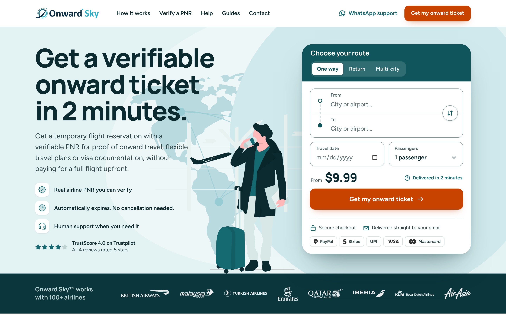

# Onward Sky — premium homepage redesign (prototype v2)

A browser-viewable, high-fidelity prototype of the Onward Sky homepage from the top of the page
through **“Be ready when proof of onward travel is requested”**. Everything below that section is
out of scope and unchanged.



**What v2 is:** the brand's own friendly identity (teal, the production orange, Figtree) taken further: a bright
departure-hall hero with a traveler in the scene, a booking card you step up to, real airline marks, and four
illustrated moments. **Every illustration, icon, logo and map was fetched from an open library and only
recolored or cropped; nothing figurative was drawn by hand** (see [`assets/SOURCES.md`](assets/SOURCES.md)).

## Preview it

The prototype is static HTML, CSS and vanilla JavaScript. There is no build step and nothing to install.

**Recommended: serve the folder locally** (fonts are preloaded and behaviour matches production):

```bash
cd onwardsky-premium-redesign
```

```bash
python3 -m http.server 8080
```

Then open <http://localhost:8080>. Any static server works (`npx serve`, VS Code Live Server, etc.).

**Quick look:** double-clicking `index.html` also works in Chrome, Edge, Firefox and Safari. Font
preloading is simply skipped under `file://`.

## What to review

| Try this | What you should see |
| --- | --- |
| Type `del`, `bom`, `bangkok` or `saigon` in **From** | Ranked airport suggestions with boxed codes; ↑/↓ + Enter or click to choose |
| Choose both airports | Each field becomes a departure-board entry (e.g. **DEL** New Delhi) and the dashed connector turns solid orange |
| Press **Get my onward ticket** with no date | Inline errors (plugin wording), a summary line, focus moves to the first problem |
| Pick a date before the minimum | “Please choose a date on or after DD/MM/YYYY (at least 10 days from today).” |
| Complete the search | A “Search ready” confirmation. **The prototype stops here — no booking, payment or redirect.** |
| Switch to **Return** | Date label becomes “Depart date”, a “Return date” field appears, passengers move beside the fare |
| Switch to **Multi-city** | Flight 2 starts where flight 1 lands; add up to 6 flights, remove down to 2 |
| Type nonsense (e.g. `zzq`) | A visible “No airports found” state with a hint |
| Phone width, scroll past the form | A sticky fare bar; its button returns you to the form and focuses **From** |
| Any “Get my onward ticket” link | Scrolls to the form and puts the cursor in **From** |
| Keyboard only | Logical tab order, visible focus everywhere, full combobox support |
| OS “reduce motion” on | The page appears without its entrance animation |

## Folder contents

```
onwardsky-premium-redesign/
├── index.html                 Prototype page (header → hero + booking card → airline band → reviews → “Be ready”)
├── assets/
│   ├── css/styles.css         Design tokens + all components + responsive rules
│   ├── js/main.js             Header menu, booking card, validation, sticky bar
│   ├── js/airports.js         Demo airport dataset (140 airports) — prototype only
│   ├── vectors/               7 unDraw illustrations, recolored to the brand palette
│   ├── airlines/ brands/      Airline marks (Soaring Symbols), payment + Trustpilot marks (Simple Icons)
│   ├── img/onward-sky-logo.svg  Client logo (from the production site)
│   ├── fonts/                 Manrope + Figtree variable fonts (self-hosted, SIL OFL licences included)
│   └── SOURCES.md             Where every fetched asset came from, its license, and the recolor map
├── tools/                     Scripts that reproduce the fetched assets (copy / recolor / crop only)
├── screenshots/               Final captures: 1440, 1280, 768, 390, 375 + card states + before/after
├── DESIGN-SYSTEM.md           Tokens, type, spacing, components, interactions
├── DESIGN-RATIONALE.md        Audit, what v1 got wrong, what changed and why
└── IMPLEMENTATION-NOTES.md    Demo-only behaviour, gaps, limitations, porting notes, QA log
```

Machine-readable design records produced by the Impeccable skill live at the repository root:
`PRODUCT.md`, `DESIGN.md` and `.impeccable/` (surface brief with the direction contract, and the
`design.json` token sidecar).

## Screenshots

| | |
| --- | --- |
| Before / after, desktop | `screenshots/before-after/compare-desktop-1440.png` |
| Before / after, mobile | `screenshots/before-after/compare-mobile-390.png` |
| First viewports (2×) | `screenshots/*-first-viewport.png` |
| Full pages | `screenshots/*-full-page.png` |
| Card + mobile states | `screenshots/states/` |

## Important

This is a design prototype, not production code. It does **not** contact the booking wizard,
checkout, payment providers or any Onward Sky endpoint, and it does not modify the live site.
See `IMPLEMENTATION-NOTES.md` for exactly what is simulated, and `assets/SOURCES.md` for the trademark
notice on the airline marks.
